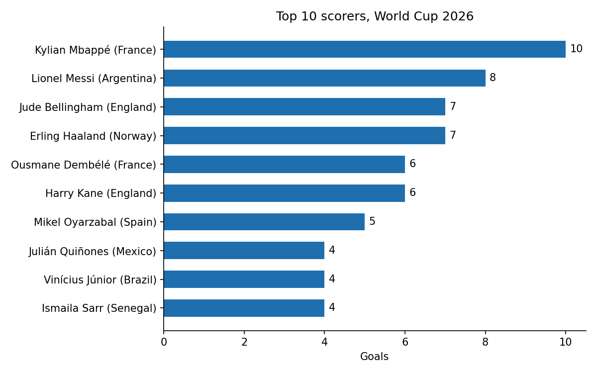
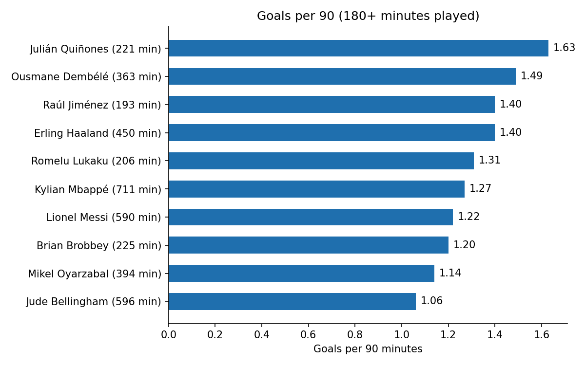
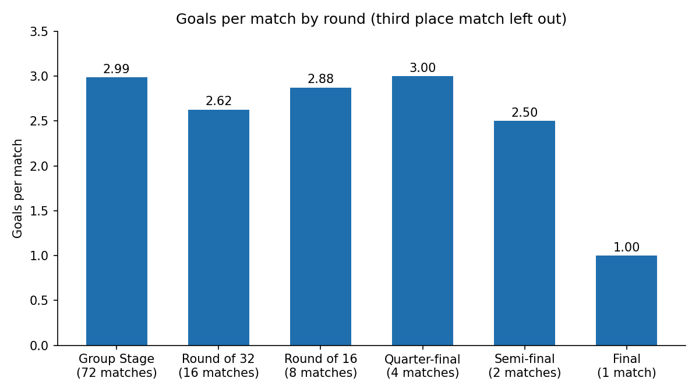
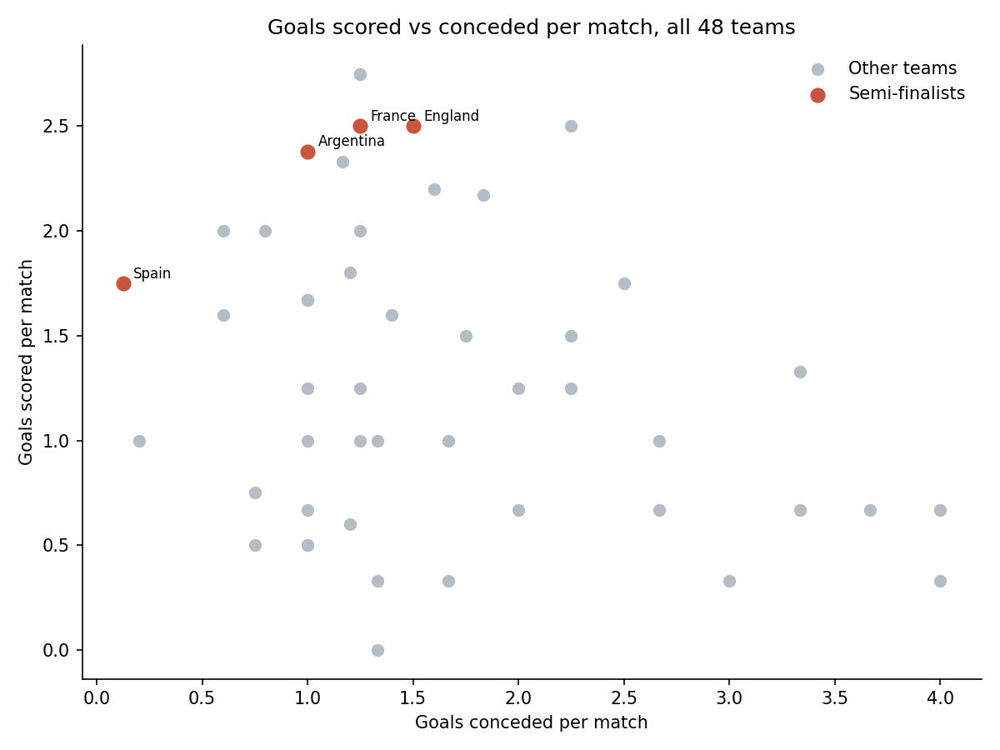
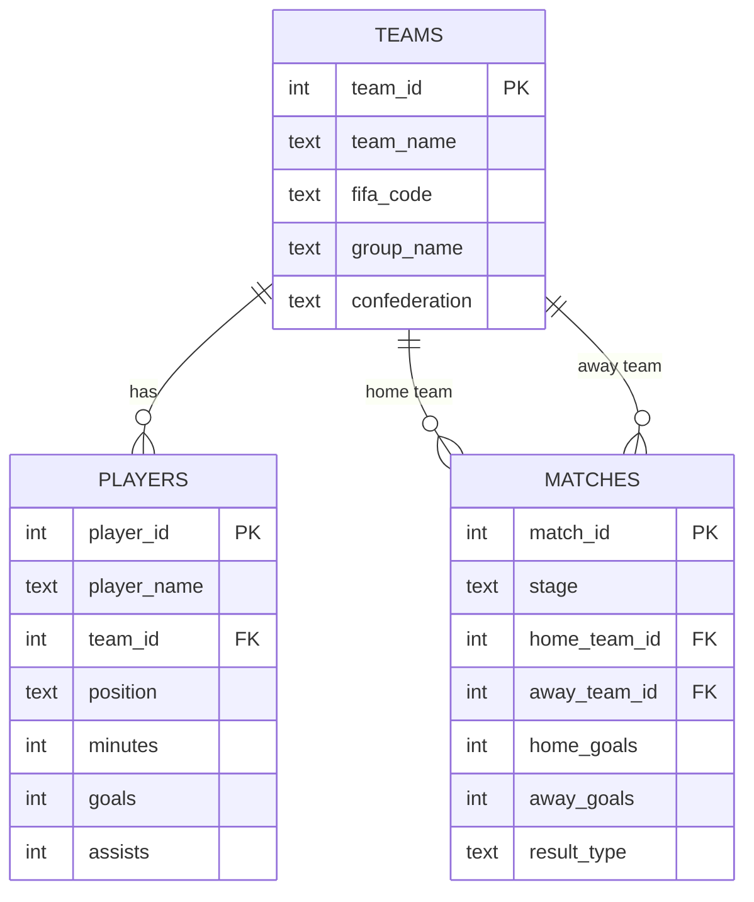

# World Cup 2026 Analysis

Player and team stats from the 2026 World Cup (48 teams, 104 matches),
cleaned with pandas, loaded into a SQLite database and queried with SQL.
I made this during my Database Management course, so the database and the
SQL are the main part.

**Website:** https://tahmidankur.github.io/fifa-wc2026-analysis/
(charts, findings and a searchable table of every player)

## Data

- Match results and player stats come from the
  [FIFA World Cup 2026 Dataset](https://github.com/mominullptr/FIFA-World-Cup-2026-Dataset)
  on GitHub (CC0).
- I checked all 104 scores against Wikipedia and they all matched.
- I also checked every goalscorer against Wikipedia's list. 6 goals were
  credited to the wrong player, so I corrected them in `data/raw/goal_fixes.csv`.

The dataset has no shots or xG for players, so this project only uses
goals, assists and minutes.

## Questions

1. Who scored the most, and who scored most often per 90 minutes?
2. Were there fewer goals in the knockout rounds?
3. Did the teams that scored the most go furthest?

## Findings

Mbappé won the Golden Boot with 10 goals, ahead of Messi (8), Bellingham (7)
and Haaland (7).

Per 90 minutes, Haaland (1.40) and Dembélé (1.49) scored more often than
Mbappé (1.27). Julián Quiñones is top with 1.63, but that's from only 221
minutes.

The 180-minute filter matters a lot. Without it, Kaan Ayhan comes out on top
with 45 goals per 90, because he scored once in his only 2 minutes on the
pitch. 479 of the 1,039 players who played got less than 180 minutes.

Group matches averaged 2.99 goals. Knockout matches averaged 2.68 (not
counting France 4–6 England in the third place match). The final was 1–0.

Spain won the tournament conceding 1 goal in 8 matches. England and France
scored the most (20 each) but conceded 12 and 10 and both lost in the
semi-finals. Scoring a lot wasn't enough on its own.

Forwards scored 0.34 goals per 90, midfielders 0.13 and defenders 0.03.

## Charts






<!-- Add after building the dashboard:

-->

## Database



- `players.team_id` links each player to their team.
- `matches` links to `teams` twice (home and away), so queries join `teams`
  twice with different aliases (query 5).
- Things like goals per 90 or a team's total goals aren't stored. The
  queries work them out, so they can't get out of sync.
- `CHECK` rules block bad data, like negative goals or a team playing itself.

## Cleaning

| Problem | Fix |
| --- | --- |
| 209 squad players never played | Removed |
| Broken names like `MARTINELLIGabriel Gabriel`, `Matheus Matheus Cunha`, `Mc` | Two rules in the script, plus 56 fixed by hand in `name_fixes.csv` |
| 6 goals credited to the wrong teammate | `goal_fixes.csv`, checked against Wikipedia |
| Switzerland 0–0 Colombia marked as a normal result | Set to Penalties (a knockout match can't end in a draw) |
| Positions written `DEF`, `MID`, `FWD` | Changed to `DF`, `MF`, `FW` |

The script also checks that player goals plus own goals add up to the
308 goals in the match scores.

## How to run it

```bash
python3 -m venv .venv
source .venv/bin/activate        # Windows: .venv\Scripts\activate
pip install -r requirements.txt

python scripts/01_clean_data.py
python scripts/02_build_database.py
python scripts/03_make_charts.py
python scripts/04_build_site.py     # copies charts + data into docs/ for the website

sqlite3 -header -column database/worldcup.db < sql/queries.sql
```

You can also open `database/worldcup.db` in
[DB Browser for SQLite](https://sqlitebrowser.org) and run the queries there.

## Files

```
data/raw/         downloaded files + my two fix lists
data/cleaned/     output of step 1
scripts/          the four steps
sql/schema.sql    CREATE TABLE statements
sql/queries.sql   10 queries
dashboard/        Power BI instructions
charts/           output of step 3
docs/             the website (GitHub Pages), filled by step 4
```

## What I learned

- Real data was messier than I expected. Some names were scrambled and a few
  goals were given to the wrong player, even though the totals were right.
- Checking against a second source caught mistakes I wouldn't have noticed.
- Per-90 stats are useless without a minimum minutes filter.
